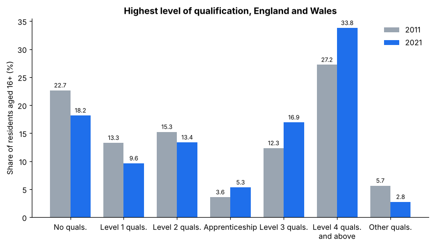
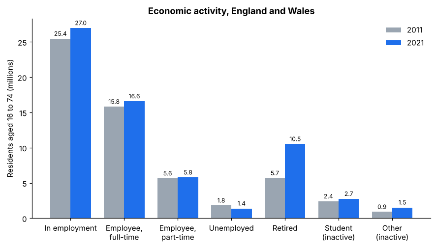
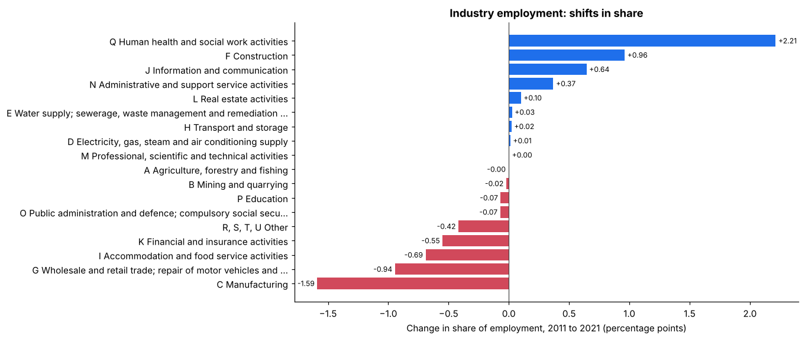
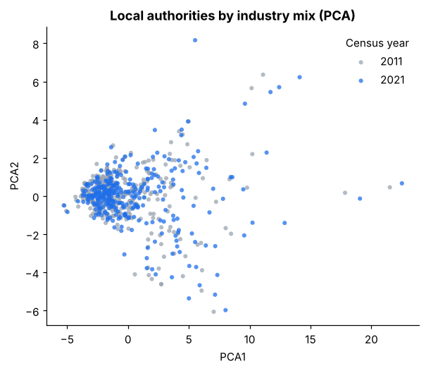
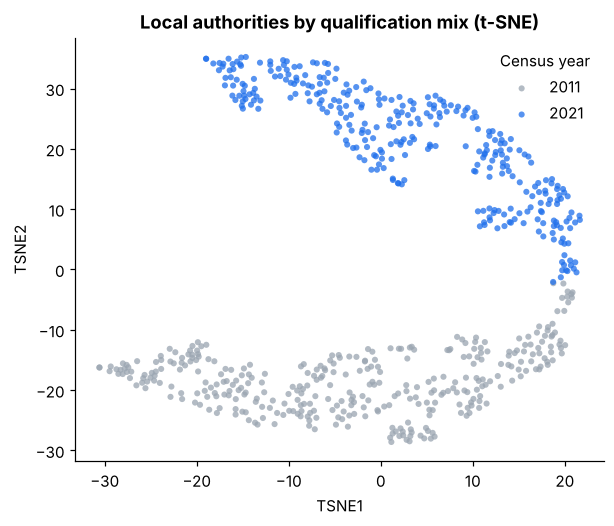

# Census Education and Employment Dashboard

An interactive Tableau analysis of how education and employment changed across England and Wales between the 2011 and 2021 censuses, backed by a reproducible Python data-preparation pipeline.

**Question:** how closely is a region's level of qualification related to the kind of work its residents do, and how did that relationship shift over a decade?

## Highlights

- Five dashboards covering qualifications, economic activity and industry of employment at Local Authority level.
- A Python pipeline that harmonises two census years (changed area codes, renamed categories, missing values) into one analysis-ready workbook.
- Dimensionality reduction (PCA on industry employment, t-SNE on qualifications) to cluster regions with similar profiles.
- A written report covering task definition, design justification, a small user evaluation and limitations.

## Findings

- **Qualifications rose.** Level 4 and above grew from 27.2% to 33.8% of residents, while those with no qualifications fell from 22.7% to 18.2%.
- **Unemployment fell.** Unemployed residents dropped from 1.8 million to 1.4 million, and employment grew in both full-time and part-time work.
- **Industry mix shifted.** Human health and social work (+2.2 percentage points of employment), construction and information and communication grew, while manufacturing (-1.6), wholesale and retail, and accommodation and food declined.
- **Regional pattern.** The report finds a north-south gap in qualification growth, with regions that progressed more slowly staying tied to lower-growth industries.

The full discussion is in [`report/report.pdf`](report/report.pdf). Figures above are shares of the England and Wales totals computed from the processed data.

## Preview charts

Static previews of the main views, generated from the processed data by [`src/make_previews.py`](src/make_previews.py). The interactive dashboards, including the choropleth maps, are in the Tableau workbook.







<p>
  
  
</p>

## Dashboards

| Dashboard | Purpose | Key insight |
| --- | --- | --- |
| Qualifications Comparison and Trends | Compare education levels, 2011 vs 2021 | Level 4+ increased significantly |
| Qualification Rate by Region | Regional differences in education change | North-south gap in qualification growth |
| Economic Activity Change | Employment type trends over time | Unemployment fell; full-time work rose |
| Industry Employment Change and PCA | Industry shifts and regional clustering | Tech and healthcare expanded in high-education regions |
| Dominant Industry and Employment Trends | Regional economic specialisation | Professional sectors dominate where education is higher |

Chart choices (grouped and stacked bars, choropleth maps, trend lines, PCA and t-SNE scatter plots) are justified against Munzner's task taxonomy in the report.

## Repository layout

```
.
├── dashboard/
│   └── england-wales-census-dashboard.twbx   Tableau packaged workbook
├── data/
│   ├── raw/                                  ONS census extracts (2011, 2021) and area-code lookup
│   └── processed/combined_sheets.xlsx        Pipeline output used by Tableau
├── report/report.pdf                         Full written report
├── docs/images/                              Preview charts
├── src/
│   ├── prepare_data.py                       Data preparation pipeline
│   └── make_previews.py                      Preview chart generator
├── requirements.txt
└── LICENSE
```

## Open the dashboard

Open `dashboard/england-wales-census-dashboard.twbx` in [Tableau Public](https://public.tableau.com/app/discover) or Tableau Desktop. The workbook is packaged with its data, so no extra setup is needed.

## Reproduce the data

Requires Python 3.10 or newer.

```bash
git clone https://github.com/Mounish16/census-education-employment-dashboard.git
cd census-education-employment-dashboard
python -m venv .venv
source .venv/bin/activate
pip install -r requirements.txt
python src/prepare_data.py
```

This writes `data/processed/combined_sheets.xlsx` with five sheets:

| Sheet | Contents |
| --- | --- |
| Economic Activity | Long format: region, area code, year, activity, count |
| Highest Qualification | Long format: region, area code, year, qualification, count |
| industry_employment | Long format: region, area code, year, industry, count |
| industry employment pca | Wide industry counts plus `PCA1`, `PCA2` |
| Highest qualification tsne | Wide qualification counts plus `TSNE1`, `TSNE2` |

To regenerate the preview charts, run `python src/make_previews.py`.

On Windows, activate the environment with `.venv\Scripts\activate`.

## Method

1. **Read** each Nomis export, skipping the seven metadata rows and the trailing footnotes.
2. **Keep England and Wales only** (area codes starting `E` or `W`).
3. **Harmonise area codes** from 2011 to 2021 Local Authority codes using the ONS lookup table.
4. **Align categories**: rename 2021 columns to the 2011 naming, drop unmatched columns, add a `Year` column and concatenate the two years.
5. **Impute missing values.** Gaps in the 2011 `Apprenticeship` and `Other qualifications` counts are filled with a Bayesian Ridge regression, trained on complete rows with the other numeric columns as features and clipped at zero because the values are counts. In the supplied extract the only gaps belong to Aberdeen City, which is outside England and Wales and is excluded, so the step acts as a safeguard for other extracts.
6. **Reshape** to long format for Tableau.
7. **Embed**: standardise, then PCA (2 components) on industry employment and t-SNE (perplexity 30, `random_state=42`) on qualifications.

## Data

Population counts by Local Authority from the Office for National Statistics, Census 2011 and Census 2021 (England and Wales), contains public sector information licensed under the [Open Government Licence v3.0](https://www.nationalarchives.gov.uk/doc/open-government-licence/version/3/). Source: [ONS Census 2021](https://www.ons.gov.uk/census/2021census).

## Limitations

- Built in Tableau Public, which has limited in-tool data preparation, so cleaning happens in Python beforehand.
- Mapping boundaries use 2011 definitions. Some 2021 area codes no longer match and appear as "unknown" on the 2021 maps.
- The 2011 imputation is a statistical estimate, not observed data.
- The evaluation was small (five participants) and informal.
- `Year` is one of the numeric features in the PCA and t-SNE steps, so the two census years separate visibly in the t-SNE view.
- The t-SNE layout depends on the library version, so regenerated coordinates can differ slightly from those packaged in the workbook.

## Tools

Python (pandas, scikit-learn, matplotlib, openpyxl), Tableau Public.

## License

Code is released under the [MIT License](LICENSE). Census data is subject to the Open Government Licence noted above.
